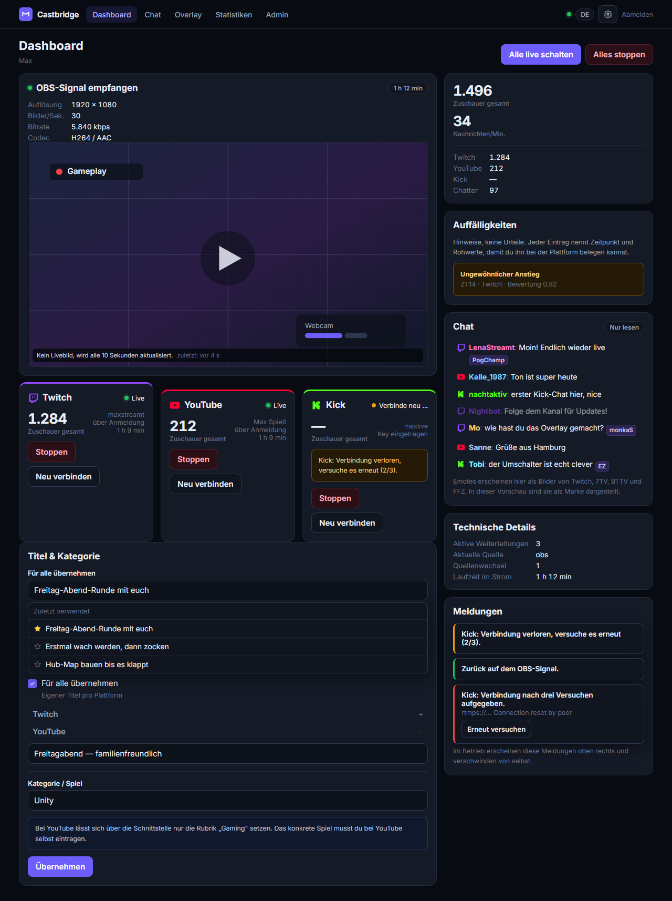
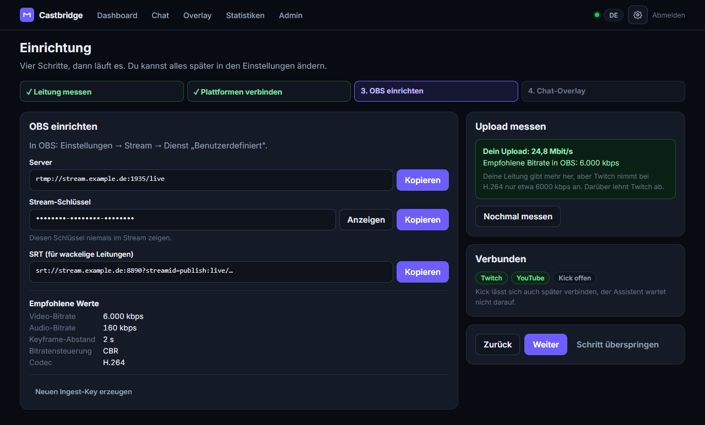
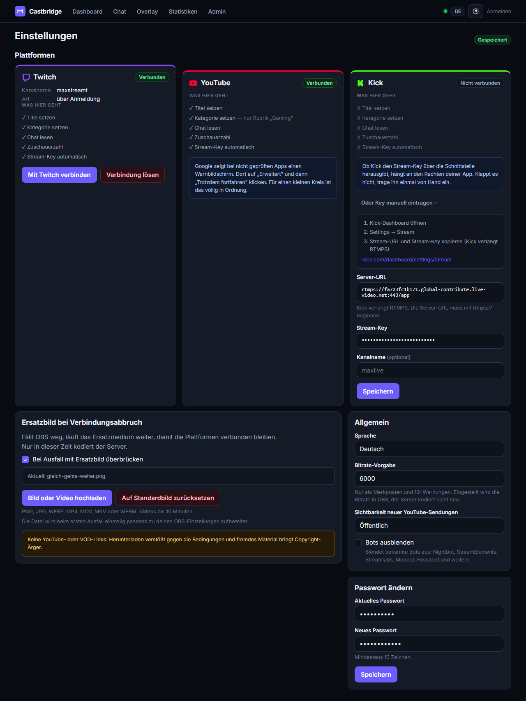
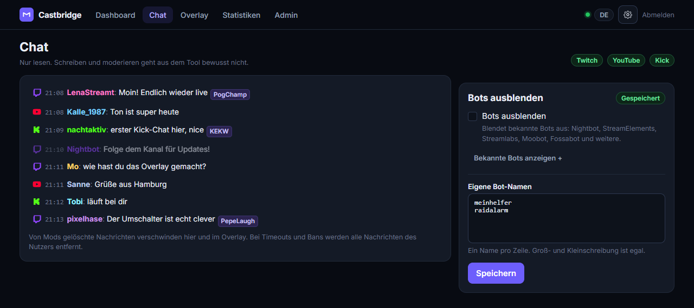
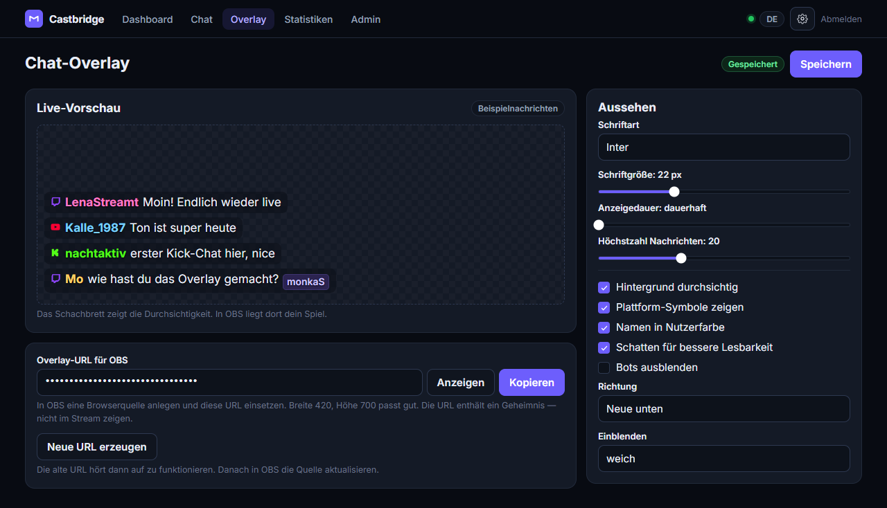
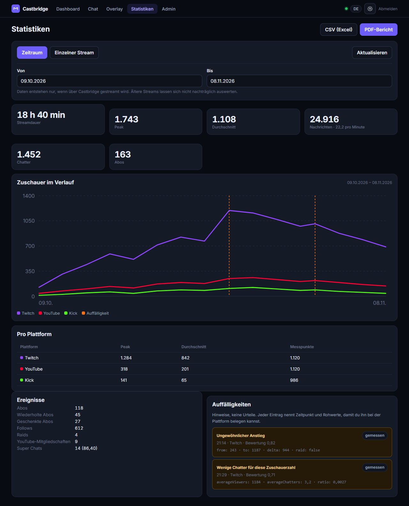
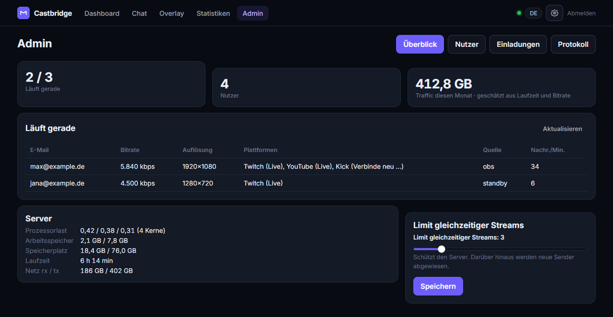

# Castbridge

Multistream-Relay für OBS. Du sendest einmal an den Server, der verteilt den
Stream unverändert an Twitch, YouTube und Kick und führt die drei Chats wieder
zusammen — im Dashboard und als Browserquelle für OBS.

[](https://github.com/HalloDerMax/castbridge/actions/workflows/ci.yml)



## Warum

Wer auf drei Plattformen gleichzeitig streamt, schickt sein Bild dreimal aus
dem Haus. Bei 6 Mbit/s pro Ziel sind das 18 Mbit/s Upload, und die meisten
Anschlüsse geben das nicht her. Dienste wie Restream.io lösen das, kosten aber
monatlich und kodieren das Video unterwegs neu.

Castbridge macht dasselbe auf eigener Hardware und **ohne Neukodierung**: was
aus OBS herauskommt, kommt bei den Plattformen an. Der Server kopiert nur die
Pakete, statt sie neu zu berechnen. Das kostet fast keine CPU und keine
Bildqualität.

## Wie es funktioniert

```
                        ┌──────────────── Server ─────────────────────────────┐
                        │                                                     │
OBS ──RTMP/SRT──► 1935 / 8890 ─► MediaMTX                                      │
                        │           │  Ingest, prüft den Key über die App      │
                        │           │                                          │
                        │           ├─► ffmpeg  OBS-Quelle      ─┐             │
                        │           │                            ├─► FLV-      │
                        │           └─► ffmpeg  Ersatzmedium    ─┘   Splicer   │
                        │                                            │        │
                        │                      ┌─────────────────────┼──────┐  │
                        │                      ├─ ffmpeg -c copy ─► Twitch  │  │
                        │                      ├─ ffmpeg -c copy ─► YouTube │  │
                        │                      └─ ffmpeg -c copy ─► Kick    │  │
                        │                                   (RTMPS)         │  │
                        │                                                     │
                        │  Fastify: REST + WebSocket, liefert auch das         │
                        │  gebaute Frontend aus                                │
                        │  Chat-Hub · Statistik-Sammler · PostgreSQL · Redis    │
                        └─────────────────────────────────────────────────────┘
```

Drei Teile, die man getrennt betrachten kann:

**Ingest.** MediaMTX nimmt RTMP und SRT an. Jeder Publish-Versuch geht vorher
als HTTP-Anfrage an die App (`POST /api/ingest/auth`), die den Stream-Key einem
Nutzer zuordnet oder ablehnt. Jeder Nutzer hat seinen eigenen Key und kann ihn
jederzeit neu erzeugen. Die ankommende Bitrate wird nicht aus OBS übernommen,
sondern aus der Byte-Differenz der MediaMTX-API berechnet — das ist der Wert,
der wirklich ankommt.

**Relay.** Pro Plattform läuft ein eigener ffmpeg-Prozess mit `-c copy`. Jeder
lässt sich einzeln starten und stoppen, ohne die anderen zu stören. Bricht eine
Verbindung ab, wird dreimal mit wachsendem Abstand neu verbunden; danach meldet
sich die Oberfläche mit einem Hinweis und einem Knopf zum erneuten Versuch.

**Web-App.** Fastify bedient REST und WebSocket und liefert im selben Prozess
das gebaute React-Frontend aus. Ereignisse (Signal, Plattform-Status,
Chat-Nachrichten, Zuschauerzahlen) gehen über einen Bus an die offenen
Browser-Verbindungen. Ohne Redis läuft der Bus prozessintern, was für einen
Server reicht; mit `REDIS_URL` verteilt er über mehrere Instanzen.

### Der Umschalter

Das ist der Teil, an dem die Sache hängt.

Fällt OBS weg, soll ein Ersatzbild einspringen, ohne dass die Plattformen die
Verbindung verlieren. Der naive Weg funktioniert nicht: ein ffmpeg, dessen
Eingang endet, beendet sich — und damit bricht auch die RTMP-Verbindung zur
Plattform ab. Ein Neustart bedeutet für Twitch und YouTube einen neuen Stream.

Deshalb sitzt zwischen Quelle und Plattform ein eigener FLV-Splicer
([`server/src/relay/flv.ts`](server/src/relay/flv.ts)):

1. OBS-Signal und Ersatzmedium laufen als je ein ffmpeg, das einen FLV-Strom
   auf die Standardausgabe schreibt.
2. Der Splicer zerlegt diesen Strom in Tags, merkt sich Kopf und
   Sequenz-Köpfe und schreibt einen durchgehenden Strom an beliebig viele
   Ausgänge.
3. Pro Plattform liest ein `ffmpeg -f flv -i pipe:0 -c copy` aus diesem Strom.
   Dieser Prozess sieht **nie** ein Dateiende, auch wenn die Quelle darunter
   getauscht wird.
4. Gewechselt wird nur auf einem Keyframe. Die Zeitstempel laufen pro Spur
   lückenlos weiter, Rückschritte werden abgefangen — sonst lehnt ein strenger
   Muxer den Strom ab.

Damit der Tausch durchgeht, wird das Ersatzmedium beim ersten Ausfall einmalig
auf die Parameter des OBS-Signals umkodiert: Auflösung, Bildrate, GOP-Länge,
Pixelformat, Bitrate, Audioformat sowie **Profil und Level** des Videos
([`relay/standby.ts`](server/src/relay/standby.ts)). Nur in dieser Zeit kodiert
der Server überhaupt.

Geprüft wird das nicht per Augenmaß, sondern im Test: zwei echte ffmpeg-Quellen,
ein Wechsel mitten im Strom, und danach muss der Weg, den das Relay geht
(`-c copy -f flv`), fehlerfrei durchlaufen.

## Oberfläche

Alle Ansichten gibt es zweisprachig (DE/EN) und sie funktionieren vollständig
auf dem Handy. Die Bilder unten zeigen Beispieldaten.

### OBS einrichten

Server, Schlüssel und die empfohlenen Werte zum Kopieren. Die Empfehlung kommt
aus einem Speedtest, der den Upload zum eigenen Server misst, nicht zu
irgendeinem Messdienst.



### Plattformen verbinden

Normalerweise per Anmeldung (OAuth), wofür der Admin die Entwickler-Apps
einmalig hinterlegt. Daneben gibt es überall den manuellen Weg mit Stream-Key,
samt Anleitung, wo man ihn findet. Jede Karte sagt ehrlich, was auf dieser
Plattform geht und was nicht.



### Chat

Die drei Chats laufen zusammen, jede Nachricht mit Plattform-Symbol. Emotes
kommen von der jeweiligen Plattform sowie von 7TV, BTTV und FFZ. Löscht ein Mod
eine Nachricht, verschwindet sie auch hier und im Overlay; bei Timeouts und
Bans alle Nachrichten der Person. Geschrieben wird aus dem Tool bewusst nicht.



### Chat-Overlay

Eigene Seite mit Token für die OBS-Browserquelle. Der Editor zeigt die
Änderungen sofort an Beispielnachrichten, und offene Overlays übernehmen neue
Einstellungen ohne Neuladen.



### Statistiken

Zuschauer im Verlauf je Plattform, Chatrate, Ereignisse, dazu Hinweise auf
auffällige Verläufe mit Zeitstempel und Rohwerten. Export als CSV und als
gestalteter PDF-Bericht.



### Admin

Es gibt keine offene Registrierung; neue Konten entstehen nur über
Einladungslinks, die ablaufen und einmal gelten. Dazu der Blick auf das, was
gerade läuft: wer sendet, mit welcher Bitrate, auf welchen Plattformen, und ob
gerade das Ersatzbild überbrückt. Das Limit gleichzeitiger Streams schützt den
Server und lässt sich im Betrieb ändern, ohne neu zu deployen.



## Stack

| Teil | Technik |
|---|---|
| Ingest | MediaMTX (RTMP 1935, SRT 8890) |
| Weiterleitung | ffmpeg, ein Prozess pro Plattform, `-c copy` |
| Server | Node 24, TypeScript, Fastify 5, `ws` |
| Datenbank | PostgreSQL 16, Migrationen als SQL-Dateien |
| Zwischenspeicher | Redis, optional |
| Frontend | React 18, Vite 6, kein UI-Framework |
| PDF | pdfkit, Diagramm von Hand gezeichnet |
| Betrieb | Docker Compose, Coolify |

Bewusst wenig Abhängigkeiten: kein ORM, kein Komponenten-Framework, keine
Auth-Bibliothek. Passwörter über `scrypt` aus der Standardbibliothek,
Stream-Keys und Tokens mit AES-256-GCM verschlüsselt in der Datenbank.

## Schnellstart

Vorausgesetzt: Node 20 oder neuer, ffmpeg im Pfad, eine PostgreSQL-Datenbank.
Für den Ingest zusätzlich MediaMTX, sonst läuft alles außer Signal, Relay und
Vorschaubild.

```bash
cp .env.example .env
```

Zwei Geheimnisse erzeugen und in die `.env` eintragen:

```bash
node -e "console.log('SECRET_KEY='+require('crypto').randomBytes(32).toString('base64'))"
```

```bash
node -e "console.log('SESSION_SECRET='+require('crypto').randomBytes(32).toString('base64'))"
```

Frontend bauen, Server starten:

```bash
npm --prefix web install
```

```bash
npm --prefix web run build
```

```bash
npm --prefix server install
```

```bash
npm --prefix server start
```

Die App läuft dann auf <http://localhost:3000> und legt beim ersten Start das
Schema sowie aus `ADMIN_EMAIL` und `ADMIN_PASSWORD` das Admin-Konto an. Wer am
Frontend arbeitet, nimmt statt des gebauten Stands `npm --prefix web run dev`
auf Port 5173; der leitet `/api` und `/ws` weiter.

Ausführlich, inklusive MediaMTX auf dem eigenen Rechner und echtem Streamen von
daheim: [docs/LOKAL.md](docs/LOKAL.md).

## Tests

```bash
npm --prefix server run verify
```

Baut und prüft in einem Lauf, ohne Datenbank, in etwa einer Minute. Die Tests
arbeiten mit echtem ffmpeg statt mit Attrappen:

| Datei | Was geprüft wird |
|---|---|
| `test/flv-splice.test.js` | Quellenwechsel mitten im Strom, Zeitstempel pro Spur, der Relay-Pfad `-c copy -f flv` |
| `test/standby.test.js` | Aufbereitung des Ersatzmediums, Profil-Zuordnung für Baseline, Main und High, Wechsel OBS → Ersatzbild |
| `test/detector.test.js` | Erkennung auffälliger Zuschauerverläufe, samt Gegenprobe mit einem echten Raid, der nicht gemeldet werden darf |
| `test/http-smoke.test.js` | Routen, Zugangsschutz, MediaMTX-Hook, Webhook-Signaturpflicht, Ausliefern der Oberfläche |

Dieselben Schritte laufen in der CI bei jedem Push, dort zusätzlich der
Docker-Build.

## Projektaufbau

```
server/
  migrations/          SQL, wird beim Start in Namensreihenfolge angewendet
  test/                Tests, laufen gegen dist/
  src/
    index.ts           Start, Fastify, Routen, Herunterfahren
    config.ts          Konfiguration aus der Umgebung
    lib/               Datenbank, Krypto, Zugang, Einladungen, Ereignisbus
    ingest/            MediaMTX-API, Überwachung, Bitrate aus Bytes
    relay/
      flv.ts           FLV-Parser und Splicer
      session.ts       eine Sitzung pro Nutzer, Relays, Neuverbindung
      standby.ts       Ersatzmedium passend aufbereiten
      thumbnail.ts     Vorschaubild alle 10 s
      manager.ts       Registry, Limit gleichzeitiger Streams
    platforms/         Twitch, YouTube, Kick, Konten und Tokens
    chat/              Hub, IRC, YouTube-Abfrage, Emotes, Bot-Liste
    stats/             Sammler, Erkennung, Abfragen, CSV- und PDF-Export
    routes/            HTTP und WebSocket
web/
  src/
    i18n/              alle Texte, DE und EN
    lib/               API, Sitzung, Live-Verbindung, Formate
    components/        Karten, Diagramm, Chat, Overlay
    pages/             Login, Einladung, Assistent, Dashboard, Chat,
                       Overlay-Editor, Overlay, Statistik, Einstellungen, Admin
mediamtx/              Konfiguration für Server und für lokal
docs/                  Anleitungen und Bilder
```

## Betrieb

[docs/DEPLOY.md](docs/DEPLOY.md) — GitHub und Coolify einrichten, und wie eine
Änderung danach von `git push` bis zum laufenden Server kommt: CI als Türsteher,
Auto-Deploy, Migrationen, Zurückrollen.

[docs/SETUP.md](docs/SETUP.md) — Subdomain, Hetzner-Firewall und die
Entwickler-Apps bei Twitch, Google und Kick, Schritt für Schritt.

Zwei Dinge, die beim Aufsetzen regelmäßig Zeit kosten:

- **1935/TCP und 8890/UDP gehen nicht über den Coolify-Proxy.** Der spricht
  HTTP. Beide Ports sind direkt am MediaMTX-Container gemappt und müssen in der
  Firewall offen sein.
- **Ein Deployment beendet laufende Streams.** Der Container wird getauscht,
  die ffmpeg-Prozesse fallen weg. Das Ersatzbild hilft dagegen nicht, es
  überbrückt einen Ausfall von OBS und keinen Neustart des Servers.

## Plattform-Eigenheiten

Hier unterscheiden sich die drei stärker, als einem lieb ist. Die Oberfläche
zeigt pro Plattform an, was geht, statt es zu verschweigen.

| | Twitch | YouTube | Kick |
|---|---|---|---|
| Protokoll | RTMP | RTMP | **RTMPS** |
| Stream-Key über API | ja | ja | unklar, wird zur Laufzeit geprüft |
| Titel setzen | ja | ja | ja |
| Kategorie | Spiel frei wählbar | nur Rubrik „Gaming" | Spiel frei wählbar |
| Chat | IRC über WebSocket | Abfrage mit Tageskontingent | Webhooks, braucht öffentliche Adresse |
| Bitrate | etwa 6000 kbps bei H.264 | höher möglich | höher möglich |

Daraus folgt für den Betrieb: Twitch ist der Engpass, nach dem sich die Bitrate
in OBS richtet. Bei YouTube lässt sich über die Schnittstelle nur die Rubrik
setzen, das konkrete Spiel muss man dort selbst eintragen. Kicks Chat kommt per
Webhook, läuft also erst auf dem Server und nicht auf dem Laptop.

## Stand

Was an echtem Material geprüft ist: der Umschalter samt Relay-Pfad gegen
ffmpeg, die Aufbereitung des Ersatzmediums über alle drei H.264-Profile, die
Erkennung auffälliger Verläufe, die HTTP-Schicht, und dass Server wie Frontend
ohne Typfehler bauen.

Was noch aussteht, weil es Zugänge und einen Server braucht: ein Durchlauf
gegen die echten Plattform-Schnittstellen. Die Aufrufe folgen der jeweiligen
Dokumentation, aber ob jeder Endpunkt genau so antwortet, zeigt erst der erste
Lauf mit eigenen Entwickler-Apps. Offen sind vor allem, ob Kick den Stream-Key
über die API herausgibt (der Code probiert drei Endpunkte und fällt sonst
sauber auf den manuellen Weg zurück) und ob YouTubes Tageskontingent im
Dauerbetrieb reicht (der Chat hält sich an die vorgeschlagene Wartezeit,
mindestens 5 Sekunden, und stellt bei `quotaExceeded` ab statt weiterzulaufen).

Ebenfalls noch nicht bewiesen: dass Twitch, YouTube und Kick den Quellenwechsel
im laufenden Betrieb schlucken. Die Parameter sind dafür gebaut und der Test
zeigt, dass der Strom technisch sauber bleibt. [docs/SETUP.md](docs/SETUP.md)
beschreibt im letzten Abschnitt, wie man das in einer Viertelstunde durchprobiert.
